# Recovered historical figures

These 15 PNGs were extracted without replotting from five saved notebooks. Cell numbers are zero-based. The figures have not been regenerated or validated by rerunning the experiments. See [legacy notes](../docs/legacy-notes.md) for metric and version limitations.

## [Homework.ipynb](../movielens/Homework.ipynb)

This notebook contains a saved interruption in cell 7; subsequent figures remain from earlier work.

### Cell 5: Q1: 50,000 steps / 10 runs

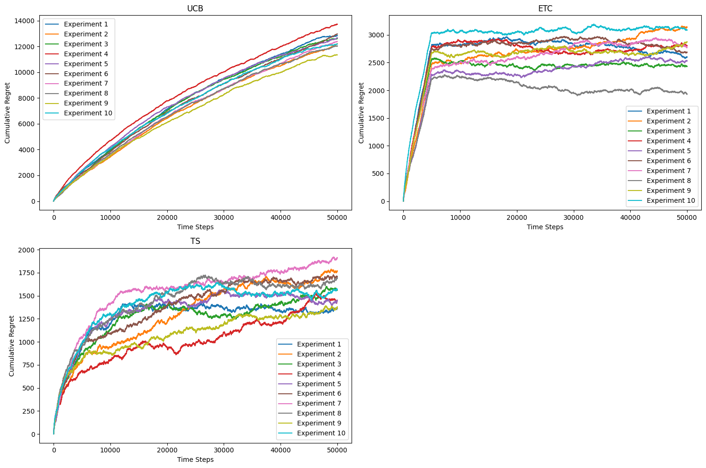

### Cell 9: Q1: 50,000 steps / 100 runs

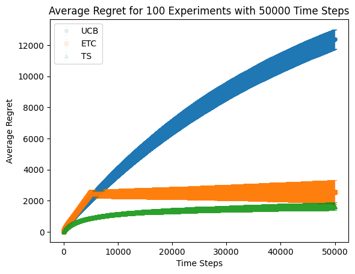

### Cell 15: Q2: horizon comparison

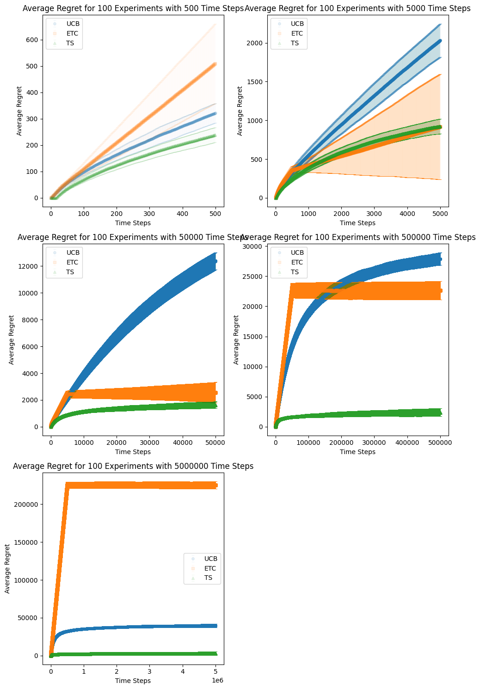

### Cell 19: Q3: ETC exploration lengths

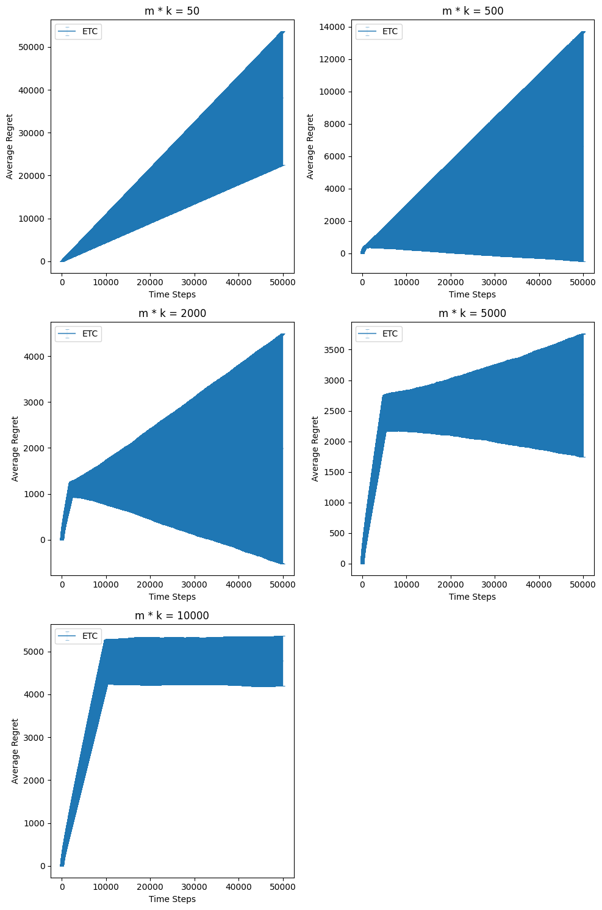

### Cell 24: Q4: UCB parameters

### Cell 27: Q5: four algorithms / 1,000,000 steps

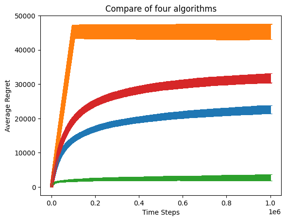

## [Homework_v2.ipynb](../movielens/Homework_v2.ipynb)

**Q2 warning:** the figure in cell 15 repeats the same 500-step result with placeholder titles. Its saved output does not match the current code and is not a valid five-horizon comparison. Q4 and Q5 have clearer legends than the original version.

### Cell 5: Q1: 50,000 steps / 10 runs

### Cell 9: Q1: 50,000 steps / 100 runs

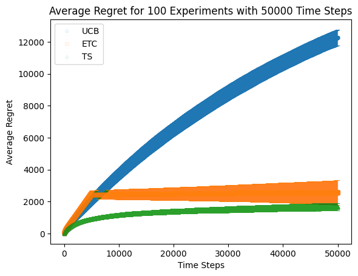

### Cell 15: Q2: horizon comparison

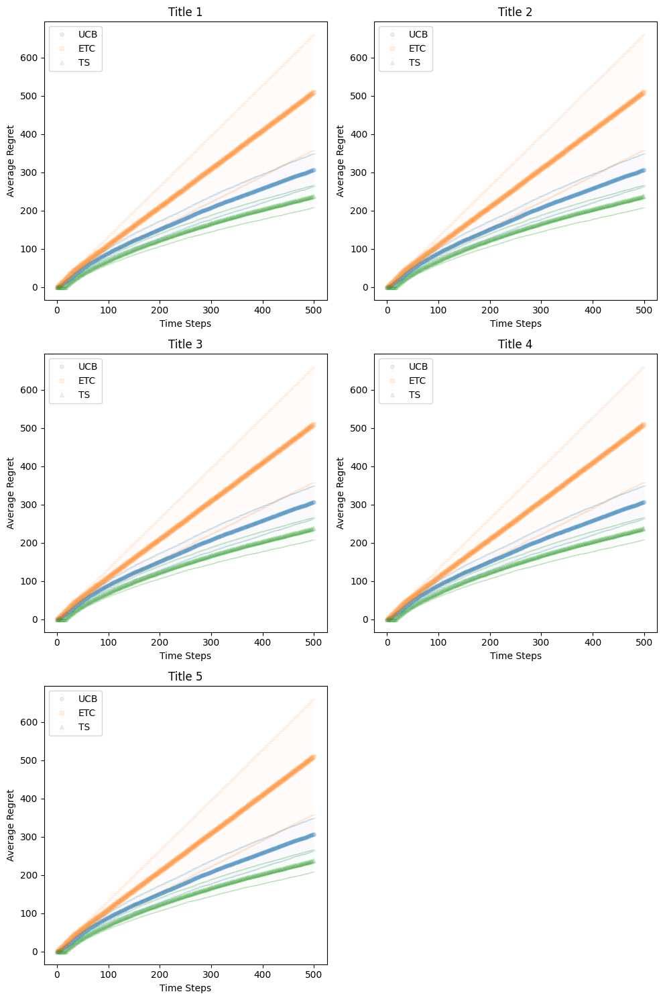

### Cell 19: Q3: ETC exploration lengths

### Cell 25: Q4: UCB parameters (with legend)

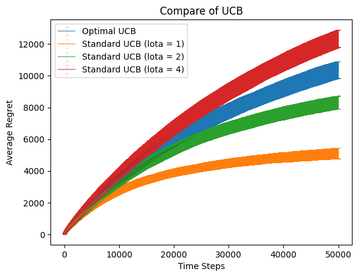

### Cell 29: Q5: four algorithms / 1,000,000 steps (with legend)

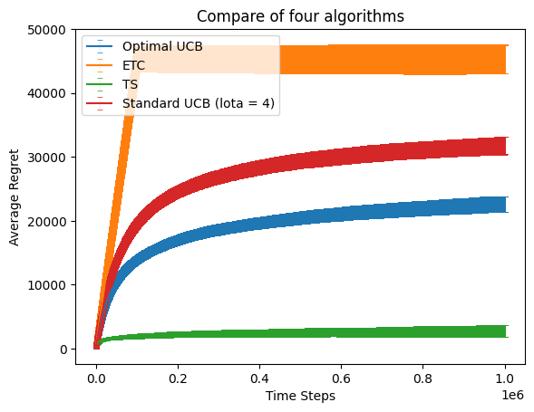

## [UCB.ipynb](../movielens/UCB.ipynb)

### Cell 2: UCB independent experiment

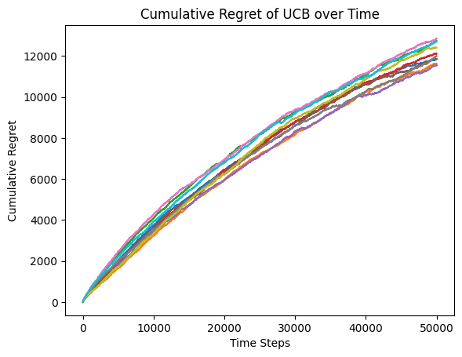

## [TS.ipynb](../movielens/TS.ipynb)

### Cell 1: TS independent experiment

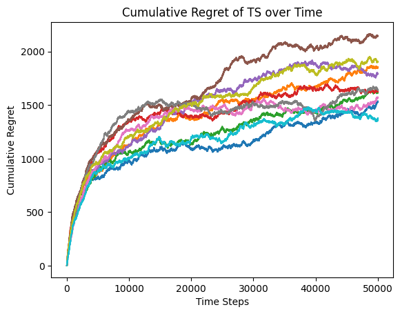

## [ETC.ipynb](../movielens/ETC.ipynb)

### Cell 2: ETC independent experiment

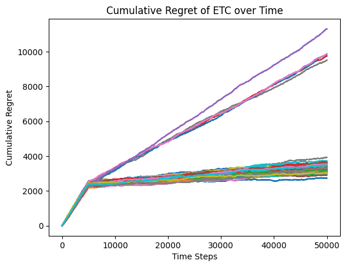
